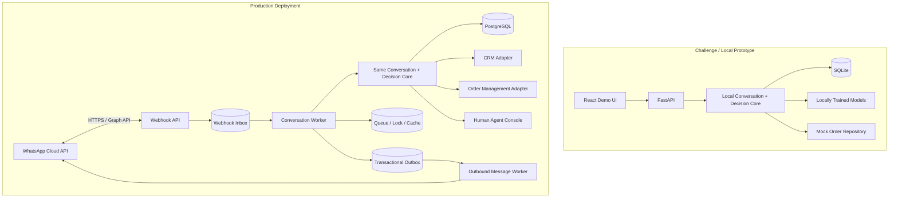
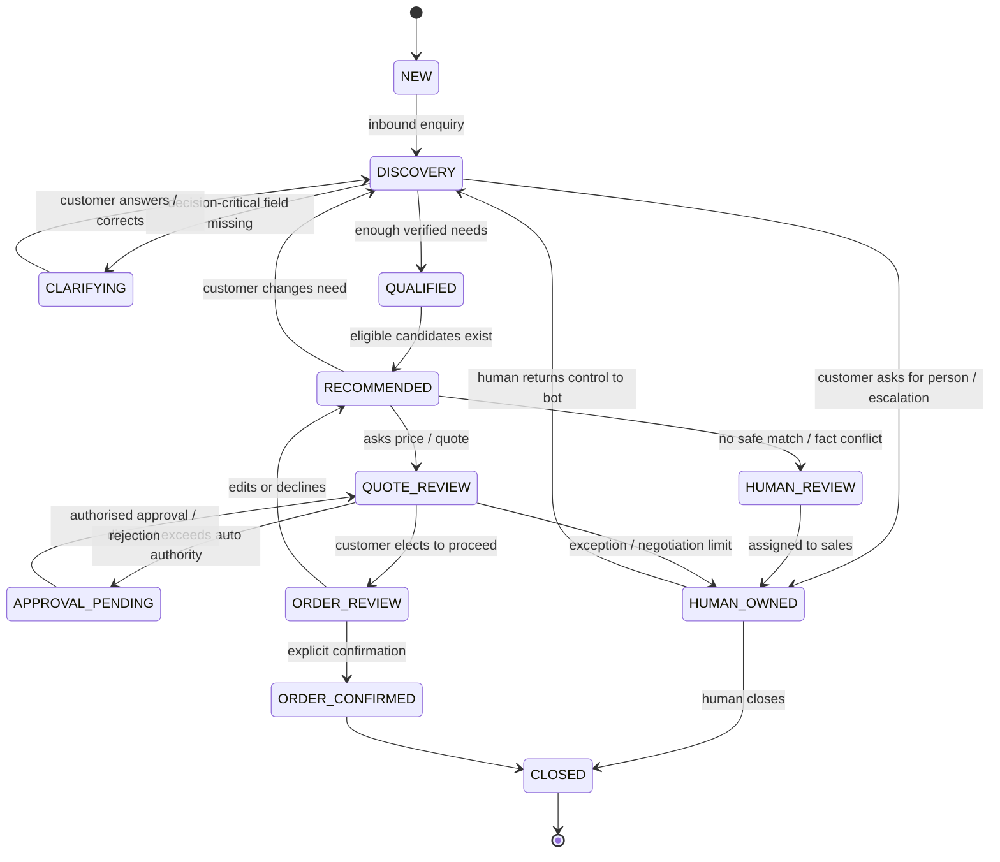

# AgriSutra — System Architecture & Engineering Specification

**Version:** 1.0  
**Status:** Proposed build specification; implementation and integration status must be updated as code is delivered.  
**Scope:** Local challenge prototype plus production-ready integration boundaries for SGB Agro Industries.

---

## 1. Architecture mission

AgriSutra is a task-oriented, catalogue-grounded sales decision system. It must understand a customer, maintain an explicit record of what is known, decide what information is still needed, recommend only eligible catalogue products, prove every product claim, and safely advance or hand off the sales workflow.

The architecture must satisfy two operating modes without maintaining two separate sales engines:

- **Challenge mode:** browser simulator, locally trained NLU, local retrieval, deterministic response templates, SQLite, simulated CRM/order actions and mock orders. No live WhatsApp messages, real customer data, external payment or real order creation.
- **Production mode:** the same dialogue, evidence and sales-policy core behind a WhatsApp Business Platform adapter, PostgreSQL, a background worker, human-agent console and approved business-system adapters.

The original project README claims a conflict between common challenge rules and track-specific AI API rules. Since the official challenge brief is not in the supplied files, the architecture defaults to the stricter interpretation: locally trained models and no hosted LLM / AI API. Keep adapters modular and ask the organiser for written clarification before introducing a different inference service.

## 2. Core architecture principles

1. **Catalogue is the product-truth boundary.** A model can interpret a message; it cannot author product specifications, prices, discounts, compatibility, inventory or delivery promises.
2. **Known, unknown and conflicting are different states.** Missing data must never silently become a positive or negative claim.
3. **Decision before prose.** Build a structured decision, its evidence and allowed action first; compose the customer-facing message from that result second.
4. **Hard constraints precede ranking.** A preference score cannot rescue a product that fails a mandatory need.
5. **State is explicit and revisable.** Every captured value has a source message, confidence, timestamp and revision history.
6. **Every external side effect is controlled.** Sending, quoting, handing off, scheduling and ordering use policy gates, idempotency and audit events.
7. **Human takeover is a first-class state.** The bot stops while a human owns the conversation.
8. **The prototype and production system share tested business rules.** Channel and persistence adapters change; recommendation and evidence policy do not.

## 3. System context

```mermaid
flowchart LR
    Customer[Customer] -->|Meta Ad / WhatsApp| Channel[Channel Adapter]
    Customer -->|Local demo| Simulator[Browser Simulator]
    Channel --> Core[AgriSutra Conversation Core]
    Simulator --> Core
    Core --> Need[Need Fingerprint]
    Core --> NLU[Local NLU]
    Core --> Decision[Sales Decision Engine]
    Catalogue[(Approved Catalogue)] --> Retrieval[Catalogue Retrieval]
    Retrieval --> Decision
    Decision --> Proof[Truth Receipt / Proofline]
    Decision --> Guard[DealGuard / Order Policy]
    Guard --> Reply[Response Composer]
    Reply --> Channel
    Reply --> Simulator
    Core --> Handoff[Human Takeover]
    Handoff --> Console[Sales Operator Console]
    Guard --> CRM[CRM / Order Adapter]
    Audit[(Event Log / Decision Replay)] <-- Core
    Audit <-- Decision
    Audit <-- Guard
```

### Deployment boundary



The production architecture is a **modular monolith plus background workers**, not a microservice fleet. It is easier to build, test and operate at the stated initial enquiry volume. Split services only when measured throughput, team boundaries or availability requirements justify it.

## 4. End-to-end message processing

A single inbound customer message follows this sequence:

1. **Ingress and identity:** receive the browser message or WhatsApp webhook; resolve the conversation using the channel and customer identifier; assign a stable internal event ID.
2. **Validation and deduplication:** production webhook requests are signature-verified against the raw request body, recorded in an inbox table and deduplicated before processing. Duplicate deliveries must not advance the dialogue twice.
3. **Normalization:** map text, button/list reply, referral/ad context, media metadata and timestamps to a provider-neutral `InboundMessage` contract. Preserve original payload in restricted audit storage when retention rules permit.
4. **Intent and slot interpretation:** predict an intent and extract product, variant, quantity, budget, intended use, configuration, must-have and preference values. Treat uncertain extraction as a candidate value, not a fact.
5. **Dialogue-state update:** update the Need Fingerprint with provenance, confidence and change history. Detect negation, correction and contradictions.
6. **Catalogue retrieval:** retrieve approved product records and relevant FAQ / source fields. Apply product and catalogue-version filters.
7. **Decision:** run hard constraints, then preference ranking. If requirements are insufficient, calculate the next useful question. If there is no safe match, mark review or handoff.
8. **Evidence construction:** create a Truth Receipt for each proposed factual product claim. Block or rephrase claims that are missing, conflicting, unapproved or stale.
9. **Policy evaluation:** check price validity, discount authority, messaging window, customer opt-out, human ownership and order-state permissions.
10. **Response composition:** build a concise, channel-appropriate answer with product images/cards where available, source-backed values and one useful next action.
11. **Side effects:** persist state and audit events. For a production outbound message or external order action, write a transactional outbox event; a worker carries out the external call and records the result.
12. **Monitoring:** record timings, decision outcome, model version and evidence IDs without logging secrets or unnecessary personal information.

## 5. Component design

| Module | Primary responsibility | Inputs | Outputs / safeguards |
|---|---|---|---|
| Channel adapters | Convert browser / WhatsApp payloads into normalized messages | Provider payloads | Provider-neutral events; channel-specific policy checks |
| NLU | Intent classification, entity / slot extraction, correction and negation cues | Text + conversation context | Typed candidates with confidence; `UNKNOWN` / fallback path |
| Dialogue manager | Orchestrate turn-by-turn state and permitted actions | Intent, slots, current state | State transition, next action and response plan |
| Need Fingerprint | Store customer requirements, preferences, unknowns, provenance and history | Candidate slot updates | Current structured need plus revision timeline |
| Catalogue service | Ingest, normalize, validate and version product data; diff versions and identify stale dependent decisions | Approved source files / admin edits | Canonical product records, ingestion warnings and Catalogue Change Radar events |
| Retrieval service | Lexical search over product names, aliases, descriptions and approved FAQs | Query + catalogue version | Ranked passages/fields with source locators; no answer generation |
| Recommendation engine | Apply eligibility constraints and rank eligible products | Need Fingerprint + catalogue snapshot | Eligible, excluded and unverified candidates with reasons |
| AskSmart | Select the next information-gathering question | Candidate set + unresolved fields | One high-value question, score breakdown and rationale |
| Counterfactual Fit | Explain exclusion and hypothetical requirement changes | Candidate decision trace | “Why not” explanation; hypothetical only, no state mutation |
| Truth Receipt | Map claims to authoritative source fields and versions | Proposed response facts | Claim/evidence graph; blocks unsupported facts |
| DealGuard | Enforce quote, discount, approval and commercial rules | SKU, current price, policy, requested concession | Allowed / denied / approval-required decision |
| Response composer | Convert approved action and facts into natural message templates | Decision object + channel | Safe user-facing response; no free-form fact creation |
| Order service | Preview, confirm and record order state | Product, quantity, approved quote, consent | Mock order in demo; production order via authorised adapter |
| Handoff service | Assign human owner and pause bot | Trigger + conversation state | Context packet, assignment, bot lock and resume control |
| Follow-up service | Schedule permitted, opted-in reminders | Consent, due time, template, conversation state | Scheduled job with suppression and policy checks |
| Audit / Decision Replay | Record and replay key decisions | Events, versions and evidence IDs | Reproducible decision trace without exposing restricted data |

## 6. SGB product-domain model

### 6.1 Product families and decision fields

The supplied six-page SGB catalogue contains seven variants. The product family is important because one free-text phrase can refer to different commercial objects.

| Family | Product IDs (proposed) | Useful customer slots | Hard gate examples |
|---|---|---|---|
| Brush cutter trolley attachment | `BCT-SIDE`, `BCT-BACK` | Needs an attachment vs complete machine; existing brush-cutter configuration (sidepack/backpack); exact machine make/model if fitment is critical | If customer explicitly needs backpack configuration, exclude sidepack SKU; exact fitment remains `UNKNOWN` until compatibility is confirmed |
| Wheel barrow | `WB-DUMPER`, `WB-NORMAL` | Need easy tipping/dumper function; materials to move; whether a standard wheel barrow is acceptable; capacity requirement | If dumper tipping is mandatory, normal model cannot satisfy it based on the available catalogue; if a required capacity is specified, both remain unverified until capacity is confirmed |
| Brush cutter machine | `VARSHA-TROLLEY`, `143R-STABLE`, `143R-WALBRO` | Needs complete machine; push-type trolley; 2-stroke preference; carburetor preference; warranty importance; runtime requirement | Explicit warranty or configuration requirement must be checked against the specific source field; missing or ambiguous specification blocks a confident match |

Product IDs are proposed stable identifiers, not identifiers printed by SGB. Use a canonical spelling and maintain alternate search aliases such as “trolly”, “trolley”, “wheel barrow” and “wheelbarrow”.

### 6.2 Normalized catalogue snapshot

| Product ID | Display name | Price (source) | Approved normalized facts currently visible | Source locator |
|---|---|---:|---|---|
| `BCT-SIDE` | SGB Brush Cutter Trolley — Sidepack | ₹3,800 | Mild-steel attachment; dual-wheel guiding trolley; intended for sidepack brush cutter; push-type operation | Catalogue p.1 |
| `BCT-BACK` | SGB Brush Cutter Trolley — Backpack | ₹4,300 | Mild-steel attachment; dual-wheel guiding trolley; intended for backpack brush cutter; push-type operation | Catalogue p.1 |
| `WB-DUMPER` | SGB Dumper Wheel Barrow | ₹8,500 | Heavy-duty; dumper mechanism; stable wheel support; use descriptions include soil, manure, farm produce and construction materials | Catalogue p.2 |
| `WB-NORMAL` | SGB Normal Wheel Barrow | ₹7,500 | Strong frame; balanced wheel design; agricultural materials, construction supplies and farm produce | Catalogue p.3 |
| `VARSHA-TROLLEY` | SGB Varsha Brush Cutter with Trolley | ₹14,000 | 52 cc; 2.1 HP; push-type trolley; run-time 1.5 hours as provided; no engine warranty | Catalogue p.4 |
| `143R-STABLE` | SGB 143R Stable Brush Cutter (GL 45) | ₹16,000 | 2-stroke; model GL 45; 2.1 HP; stable carburetor; 6-month engine warranty | Catalogue p.5 |
| `143R-WALBRO` | SGB 143R WALBRO Brush Cutter (GL45 143R) | ₹21,000 | 2-stroke; model GL45 143R; 2.1 HP; WALBRO carburetor; 1-year engine warranty; run-time 3 hours as provided | Catalogue p.6 |

**Important ingestion flags:**

- The “95 litre” phrase for `WB-NORMAL` is present in page 3 SEO tags only, not in its specification table. Keep it as `marketing_keyword_unverified`; do not expose it as a confirmed capacity.
- The artwork for `143R-STABLE` and `143R-WALBRO` shows “43 cc”, while the specification tables omit engine capacity. Store the artwork observation separately and create a `SOURCE_CONFLICT / NEEDS_APPROVAL` flag. The public answer layer must not state 43 cc until SGB resolves it.
- Run-time figures are marked “as provided” and lack a test method. Label them `source_qualifier: as_provided` and do not state them as guaranteed runtime.
- No stock status, delivery date, discount rule, warranty term for trolley / wheelbarrow products, exact trolley fitment matrix, load capacity or dimensions are provided. These fields begin as `UNKNOWN`.
- The PDF prices have no effective date or tax-treatment field. They can be used for a clearly labelled prototype only; production prices require an SGB-approved, effective-dated price list.

### 6.3 Catalogue record contract

```json
{
  "product_id": "BCT-SIDE",
  "display_name": "SGB Brush Cutter Trolley — Sidepack",
  "family": "brush_cutter_trolley_attachment",
  "aliases": ["sidepack trolley", "side pack trolley", "brush cutter trolley sidepack"],
  "specifications": {
    "frame_material": {"value": "mild steel", "unit": null, "evidence_id": "ev-p1-frame", "status": "APPROVED"},
    "wheel_design": {"value": "dual-wheel guiding trolley", "unit": null, "evidence_id": "ev-p1-wheel", "status": "APPROVED"},
    "configuration": {"value": "sidepack", "unit": null, "evidence_id": "ev-p1-config", "status": "APPROVED"}
  },
  "price": {
    "amount": 3800,
    "currency": "INR",
    "unit": "each",
    "effective_from": null,
    "effective_to": null,
    "approval_status": "SOURCE_TRANSCRIBED_NOT_PRODUCTION_APPROVED"
  },
  "availability": {"status": "UNKNOWN", "source_id": null, "checked_at": null},
  "warranty": {"status": "NOT_STATED", "details": null},
  "source": {
    "file": "SGB_Agro_Industries_Product_Catalogue_Updated.pdf",
    "page": 1,
    "source_hash": "SHA256_OF_SOURCE_FILE",
    "catalogue_version": "catalogue-import-version"
  }
}
```

The JSON is a schema example. `SHA256_OF_SOURCE_FILE` and version values must be computed during ingestion; do not store placeholders in production data. For fields that may conflict, store multiple observations with status and source rather than choosing one silently.

## 7. Conversation state and Need Fingerprint

### 7.1 State model



Additional flags can run alongside the main state: `OPTED_OUT`, `SUPPRESSED`, `BOT_PAUSED`, `FOLLOW_UP_PENDING`, `QUOTE_EXPIRED`, and `ORDER_SYNC_PENDING`. Do not use a single status field to encode every dimension.

### 7.2 Need Fingerprint data model

```json
{
  "conversation_id": "conv_...",
  "revision": 12,
  "slots": {
    "product_family": {
      "value": "brush_cutter_trolley_attachment",
      "normalized_value": "brush_cutter_trolley_attachment",
      "kind": "REQUIREMENT",
      "status": "KNOWN",
      "confidence": 0.98,
      "source_message_id": "wamid-or-demo-message-id",
      "captured_at": "ISO-8601",
      "supersedes": null
    },
    "trolley_configuration": {
      "value": "backpack",
      "kind": "HARD_CONSTRAINT",
      "status": "KNOWN",
      "confidence": 0.99,
      "source_message_id": "message-id",
      "captured_at": "ISO-8601"
    },
    "exact_machine_compatibility": {
      "value": null,
      "kind": "HARD_CONSTRAINT_IF_CUSTOMER_REQUIRES_IT",
      "status": "UNKNOWN",
      "confidence": 0.0,
      "source_message_id": null,
      "captured_at": null
    }
  },
  "contradictions": [],
  "open_questions": ["exact_machine_compatibility"],
  "last_updated_message_id": "message-id"
}
```

Every field update must create a history record. A correction marks the earlier value `SUPERSEDED`; it does not delete it. Contradictory active statements result in `CONFLICTED` and a clarifying question unless recency and explicit correction language resolve the change deterministically.

### 7.3 Suggested intent set

- `SELECT_PRODUCT_FAMILY`
- `DISCOVER_PRODUCT`
- `ASK_PRODUCT_FACT`
- `COMPARE_PRODUCTS`
- `STATE_REQUIREMENT`
- `CORRECT_REQUIREMENT`
- `RAISE_PRICE_OBJECTION`
- `REQUEST_DISCOUNT`
- `EXPRESS_BUYING_INTENT`
- `REQUEST_QUOTE`
- `CONFIRM_ORDER`
- `EDIT_ORDER`
- `CANCEL_OR_STOP`
- `REQUEST_FOLLOW_UP`
- `ASK_FOR_HUMAN`
- `CUSTOMER_SUPPORT`
- `OPT_OUT`
- `UNKNOWN`

`EXPRESS_BUYING_INTENT` and `CONFIRM_ORDER` must be different classes. “Looks good”, “send details” or “I am interested” is not order confirmation.

## 8. AskSmart — Question Value Engine

### 8.1 Objective

Ask one question that is likely to change the decision, not every possible question. A question is useful when its possible answers partition the remaining candidate set or resolve a mandatory requirement.

### 8.2 Explainable scoring

For a candidate question `q`, let `C` be the current candidate set and `Aq` the plausible answer partitions. Estimate answer probabilities from the current candidate distribution or configured domain priors; do not claim a learned Bayesian distribution if none exists.

```text
InformationGain(q) = H(C) - Σ_a P(a | q) × H(C | answer=a)

QuestionValue(q) = Criticality(q) × InformationGain(q)
                   - λ × CustomerEffort(q)
                   - μ × PrivacyCost(q)
```

Where `H` is entropy, `Criticality` weights decision importance, `CustomerEffort` estimates how difficult the question is to answer, and `PrivacyCost` discourages collection of unnecessary personal data. Mandatory unknowns receive a blocking priority even when their candidate partition has low entropy.

### 8.3 Practical first implementation

1. Build candidate products after applying known hard constraints.
2. Enumerate unresolved attributes that distinguish those candidates.
3. Generate safe answer choices from known catalogue values where possible.
4. Score the candidate questions using partition balance / expected entropy reduction, decision criticality and customer burden.
5. Ask the highest-scoring short question; do not ask more than one at once unless the customer explicitly requests a form.
6. Recompute after the next answer and log question score, candidate count before/after and whether the answer resolved the uncertainty.

A simple candidate-partition implementation is sufficient for seven initial catalogue variants. A contextual bandit or reinforcement-learning policy is an optional research phase after collecting consented, reviewed interaction data; it is not a hackathon dependency.

## 9. Recommendation and Counterfactual Fit

### 9.1 Candidate evaluation

Each product is evaluated against every customer requirement as:

- `PASS` — supported by an approved catalogue field and matches the requirement.
- `FAIL` — a supported catalogue fact contradicts the requirement.
- `UNKNOWN` — the catalogue cannot establish the answer.
- `CONFLICTED` — approved source observations disagree or the product record is awaiting resolution.

Decision rules:

- Any hard-constraint `FAIL` → `EXCLUDED`.
- Any hard-constraint `UNKNOWN` or `CONFLICTED` → `UNVERIFIED`; clarify or hand off before calling it a confirmed match.
- All hard constraints `PASS` → eligible for soft-preference ranking.
- No eligible candidate → explain the blocking facts and request human review or a changed requirement.

### 9.2 Soft-preference ranking

For eligible products only:

```text
preference_fit = Σ(weight_i × match_i) / Σ(weight_i)
```

Include only preference fields with a known value and comparable evidence. `match_i` is a documented scale (for example 0 or 1 for exact categorical preferences); do not treat missing information as a zero. If there are no comparable known preferences, show a neutral comparison instead of fabricating a percentage. Store the scoring configuration version with each recommendation.

### 9.3 SGB-specific disambiguation

- “Brush cutter trolley” can mean a trolley attachment for an existing machine or the SGB Varsha complete brush cutter with push-type trolley. Ask which one the customer wants before recommending.
- “Trolley” should lead to Sidepack / Backpack only after the customer's brush-cutter configuration is known. For exact machine model compatibility, use a verified fitment matrix or hand off.
- “Wheel barrow” branches into Normal / Dumper. If easy tipping is required, the dumper mechanism is a decision-critical attribute. Do not infer load capacity for either option.
- “Brush cutter” may refer to Varsha with trolley, 143R Stable or 143R WALBRO. Warranty or carburetor preferences can distinguish known catalogue facts; do not turn the displayed 43 cc artwork text into an approved specification without SGB review.

### 9.4 Counterfactual Fit Lab

For an excluded product, show:

- the exact failed or unknown criterion;
- the source field that establishes the mismatch or the source gap;
- whether changing the customer's requirement would make the product eligible;
- the alternative product that currently satisfies the requirement, if one exists.

The interface must clearly label this as a **hypothetical**. It must not edit the customer's Need Fingerprint or silently relax a hard constraint. The customer must explicitly correct the requirement before the system recalculates.

## 10. Truth Receipt / Proofline

### 10.1 Evidence object

```json
{
  "receipt_id": "tr_...",
  "conversation_id": "conv_...",
  "recommendation_id": "rec_...",
  "catalogue_version": "catalogue-v...",
  "created_at": "ISO-8601",
  "claims": [
    {
      "claim_id": "claim_...",
      "subject_product_id": "BCT-SIDE",
      "claim_type": "frame_material",
      "rendered_value": "mild steel",
      "source_field": "specifications.frame_material.value",
      "source_file": "SGB_Agro_Industries_Product_Catalogue_Updated.pdf",
      "source_page": 1,
      "source_hash": "SHA256_OF_SOURCE_FILE",
      "evidence_status": "SUPPORTED",
      "approval_status": "APPROVED"
    }
  ],
  "requirements_checked": [],
  "limitations": [],
  "excluded_candidates": []
}
```

### 10.2 Evidence statuses

| Status | Meaning | Customer-facing behaviour |
|---|---|---|
| `SUPPORTED` | Exact value is present in approved source | May state the fact with its approved qualifier |
| `MISSING` | No source field establishes the requested fact | Say it is not available in the supplied information; ask / hand off |
| `CONFLICTED` | Source locations disagree or source artwork conflicts with spec table | Do not choose one silently; mark for review |
| `STALE` | Price / policy / stock value is outside its validity window | Do not quote as current; refresh or hand off |
| `UNAPPROVED` | Value entered but not approved by authorised owner | Do not expose as a confirmed fact |
| `DERIVED` | Computed directly from approved inputs by a documented deterministic formula | Show the inputs and method; never present as a manufacturer specification |

### 10.3 Response gate

Every product claim in a response must reference a receipt claim. If the composer requests an unsupported field, the evidence gate rejects that sentence and selects an uncertainty / escalation template. The model's confidence score is not product evidence.

## 11. DealGuard — approved pricing and objection handling

The supplied catalogue contains list prices only. It does **not** contain a discount matrix, floor prices, expiry dates, region rules or approval limits. Therefore the initial implementation can show catalogue-listed prices in the demo, but it must not offer discounts or negotiate a special rate.

Production DealGuard requires an authorised policy record such as:

```json
{
  "policy_id": "price-policy-id",
  "product_id": "WB-DUMPER",
  "currency": "INR",
  "list_price": 8500,
  "effective_from": "ISO-8601",
  "effective_to": "ISO-8601",
  "minimum_approved_price": null,
  "maximum_discount_percent": 0,
  "auto_approval_limit": 0,
  "approval_role": "sales_manager",
  "approved_by": "employee-id",
  "approved_at": "ISO-8601",
  "version": 1
}
```

The values above are illustrative only. An absent minimum price or limit must not be interpreted as permission. Policy outcomes are `ALLOW`, `DENY`, `REQUIRES_APPROVAL`, `EXPIRED` or `NO_POLICY`. The response composer may only communicate the approved outcome. All concessions, override decisions and approver identities are audited.

## 12. Human takeover and follow-up

### Human Takeover Packet

When a handoff is triggered, create one context packet containing:

- customer/conversation reference and permitted contact details;
- full transcript or the retention-compliant transcript reference;
- concise conversation summary and current lead state;
- Need Fingerprint with current and superseded values;
- products considered, excluded candidates and reasons;
- latest Truth Receipt and catalogue version;
- quoted price and DealGuard decision, if present;
- unresolved questions and conflicting source data;
- handoff reason, urgency, queue and timestamp.

When the human takes ownership, set `BOT_PAUSED=true` and acquire a conversation ownership lock. Inbound customer messages are still recorded and surfaced to the agent, but the bot must not send automated replies. Resume only after the human explicitly returns control.

### Follow-up scheduler

A follow-up is created only when the customer has requested or consented to it and the channel policy allows the outbound message. Store the reason, due time, message category, template ID, consent/opt-out state and suppression rules. Re-check consent, opt-out and WhatsApp service-window/template requirements at send time—not only at schedule time.

## 13. API contracts

These are proposed internal endpoints. They are not live services yet.

| Method / route | Purpose | Key behaviour |
|---|---|---|
| `POST /api/v1/sessions` | Start a local or production conversation | Creates isolated state and channel metadata |
| `POST /api/v1/sessions/{id}/messages` | Process a customer message | Requires idempotency key; returns reply, state revision and action |
| `GET /api/v1/sessions/{id}/summary` | Read lead summary | Enforces session / agent access control |
| `GET /api/v1/sessions/{id}/need-fingerprint` | Inspect structured requirements | Returns current values and provenance, not hidden personal data |
| `GET /api/v1/sessions/{id}/evidence` | Inspect Truth Receipts | Returns claim/source relationships for the session |
| `GET /api/v1/products` | Search approved product catalogue | Supports family, variant and attribute filters |
| `POST /api/v1/sessions/{id}/quote-preview` | Prepare a quote | Checks price validity and DealGuard; does not promise a discount |
| `POST /api/v1/sessions/{id}/order-preview` | Prepare order review | Shows product, quantity, approved price, terms and simulation/production label |
| `POST /api/v1/sessions/{id}/order-confirmation` | Confirm order | Requires explicit confirmation bound to the current preview version |
| `POST /api/v1/sessions/{id}/handoff` | Transfer to human | Produces packet, assigns owner and pauses bot |
| `POST /api/v1/sessions/{id}/resume-bot` | Return control to automation | Requires explicit agent action |
| `POST /webhooks/whatsapp` | Receive production webhook events | Signature verification, fast persistence, idempotent processing |
| `GET /webhooks/whatsapp` | Meta webhook challenge verification | Validates configured verify token and returns challenge |

### Message response example

```json
{
  "conversation_id": "conv_123",
  "message_id": "msg_456",
  "state": "CLARIFYING",
  "state_revision": 8,
  "reply": {
    "text": "Are you looking for a trolley for a sidepack or backpack brush cutter?",
    "product_cards": [],
    "evidence_receipt_id": null
  },
  "next_action": "ASK_CLARIFYING_QUESTION",
  "need_fingerprint": {
    "known_slots": ["product_family"],
    "unknown_slots": ["trolley_configuration"]
  },
  "decision_trace_id": "trace_789"
}
```

## 14. Persistence model

Use relational storage for business entities and event relationships. The prototype can use SQLite with the same logical schema; production should use PostgreSQL.

| Entity | Important fields | Notes |
|---|---|---|
| `Conversation` | id, channel, external_thread_id, customer_ref, state, owner_type, bot_paused, created_at, updated_at | Unique channel + external thread; scope all queries to conversation |
| `Message` | id, conversation_id, provider_message_id, direction, type, text, timestamp, status | Unique provider message ID; protect content with retention policy |
| `NeedSlotRevision` | id, conversation_id, slot_key, value_json, status, confidence, source_message_id, supersedes_id | Append-only revisions for corrections and audit |
| `CatalogueItem` | product_id, family, display_name, active | Stable product identity |
| `CatalogueVersion` | id, source_hash, imported_at, approved_by, status | Immutable snapshots; version every import |
| `CatalogueFact` | product_id, version_id, field_path, value_json, unit, qualifier, evidence_status, source_locator | Supports exact field-level evidence |
| `PricePolicy` | product_id, version, currency, list_price, validity, discount limits, approver | Separate product facts from commercial rules |
| `Recommendation` | id, conversation_id, fingerprint_revision, catalogue_version, algorithm_version, candidates_json | Persist candidate decisions and reasons |
| `TruthReceipt` | id, recommendation_id, claims_json, created_at | A response-time proof object |
| `Quote` | id, conversation_id, price_policy_version, line_items, expiry, status | Must be immutable once presented; amendments create a new version |
| `Order` | id, conversation_id, quote_id, order_type, confirmation_message_id, status, external_order_id | Demo order has `order_type=MOCK`; production order only via authorised service |
| `Handoff` | id, conversation_id, queue, assigned_agent, reason, context_snapshot, status | Bot pauses while open / agent-owned |
| `FollowUp` | id, conversation_id, due_at, template_id, purpose, consent_snapshot, status | Re-check permission at dispatch |
| `WebhookInbox` | provider, event_key, received_at, payload_hash, status, attempts | Unique event key prevents duplicate processing |
| `OutboxEvent` | id, event_type, aggregate_id, payload, status, attempts, next_retry_at | Reliable delivery of outbound effects |
| `AuditEvent` | id, actor, event_type, aggregate_id, payload_redacted, created_at | Append-only; restrict personal data |

### Required uniqueness and concurrency controls

- Unique `(channel, provider_message_id)` for inbound/outbound provider events where IDs exist.
- Unique internal idempotency key for every order confirmation request.
- Lock or optimistic revision check on a conversation while updating the Need Fingerprint.
- Unique external CRM/order reference after sync.
- Use transactional outbox rather than calling CRM/payment while holding the state-update transaction open.

## 15. WhatsApp adapter — production only

### Required behaviours

- Provide a publicly reachable HTTPS webhook endpoint and implement Meta's verification GET request.
- Validate `X-Hub-Signature-256` using HMAC-SHA256 over the raw request body and the configured Meta App Secret; compare signatures safely.
- Persist each event to `WebhookInbox` and return `200 OK` quickly; process the event asynchronously.
- Deduplicate message deliveries. Meta webhook events may be retried; design for repeated delivery and out-of-order status updates.
- Send outbound messages through the current documented Cloud API version; keep API version and credentials in deployment configuration.
- Use approved templates for business-initiated messages outside the customer service window. During the 24-hour customer service window opened/reset by a user's message, non-template replies are permitted under current policy.
- Record and respect opt-in and opt-out. Do not send promotional / follow-up messages merely because a phone number appeared in a lead.
- Provide an obvious human-agent escalation path. Pause the bot whenever a human owns the conversation.
- Handle delivery/read/failure statuses and API rate/quality signals without treating `send accepted` as `delivered`.

Meta's currently published Business Messaging Policy states that the user must have provided their number/username and opted in to subsequent messages, that opt-outs must be honoured, that free-form replies are restricted to the 24-hour customer service window, and that automation must have clear escalation paths. Re-check the policy before launch.

### Idempotent webhook algorithm

```text
receive HTTPS request
  -> verify signature against raw bytes
  -> parse envelope
  -> for each event:
       derive provider event key (message ID where available)
       INSERT WebhookInbox(event_key, payload_hash, status=RECEIVED)
       ON CONFLICT(event_key) DO NOTHING
  -> commit
  -> return 200 OK

worker:
  -> claim pending inbox event
  -> begin transaction
  -> lock conversation / verify expected revision
  -> normalize and apply event once
  -> append Message + AuditEvent + state updates
  -> enqueue response in OutboxEvent if allowed
  -> mark inbox event PROCESSED
  -> commit

outbound worker:
  -> verify consent, 24-hour window/template and human ownership again
  -> call Cloud API
  -> store provider message ID and status
  -> retry transient failure with bounded backoff; do not retry permanent policy errors
```

Meta's generic webhook documentation says it signs notifications with `X-Hub-Signature-256`, expects an HTTPS endpoint, and retries failed notifications for up to 36 hours; it explicitly recommends deduplication. Verify WhatsApp-specific payload fields against the current WhatsApp Webhooks reference before implementation.

## 16. Prototype model and training pipeline

### 16.1 Recommended first baseline

- Word and character n-gram TF-IDF features.
- Logistic Regression or Linear SVM trained locally on labelled intents.
- Catalogue-derived aliases and deterministic unit-aware slot parsers.
- Correction / negation rules for “actually”, “instead”, “not”, “change it to”, “I meant” and equivalent reviewed variants.
- Local BM25 or TF-IDF retrieval over product descriptions and approved FAQ entries.
- Template response composer using approved values, not a hosted generative model.

This baseline is intentionally small, explainable, trainable and compatible with a strict no-hosted-LLM interpretation. It is not assumed to be multilingual or production-accurate without evaluation.

### 16.2 Training data plan

1. Define the intent and slot schema from the real SGB product families and sales journey.
2. Author and review examples for guided choices, short free text, spelling mistakes, code-mixed expressions if in scope, corrections, objections and order-state ambiguity.
3. Label data with at least two reviewers for high-risk classes such as `CONFIRM_ORDER`, `OPT_OUT` and `REQUEST_DISCOUNT`; resolve disagreements.
4. Split by conversation template / source scenario, not random near-duplicate utterances, so paraphrase leakage does not inflate the test score.
5. Keep a frozen held-out test set and an adversarial suite.
6. Record model version, training data version, feature configuration and evaluation report.
7. Improve only through reviewed labels and controlled retraining; do not auto-learn from live customer messages without review and an approved data process.

### 16.3 Confidence and abstention

Calibrate intent confidence on validation data. Thresholds are per intent and configured, not guessed globally. Low confidence on a low-risk question can trigger clarification. Low confidence on `CONFIRM_ORDER`, `OPT_OUT`, a discount approval, or a cancellation must block the side effect and ask for confirmation / handoff. Confidence never replaces catalogue evidence.

## 17. Security, privacy and reliability architecture

- TLS for all external traffic; secrets stored in a secret manager or protected environment, never in Git.
- Verify Meta signatures before parsing or processing webhook events.
- Role-based access for sales agents, managers and catalogue administrators.
- Encrypt sensitive customer identifiers and restrict access to phone/address fields. Use pseudonymous IDs in analytics.
- Enforce conversation ownership in every API query; do not trust a client-supplied conversation ID alone.
- Separate catalogue content from customer personal data; never put phone numbers or addresses in the product index.
- Log decision IDs, catalogue versions, rule versions and outcome codes; redact message content and personal fields unless operationally necessary and authorised.
- Implement configurable retention, deletion and customer-rights workflows following legal review.
- Use backups, restore tests, health checks, queue monitoring and a documented incident process.
- Suppress automation for opt-outs, human-owned conversations, invalid price policy, unresolved product conflicts and system degradation.

For India, the DPDP Act and Rules have phased commencement. The Digital Personal Data Protection Rules, 2025 Gazette states Rules 1, 2 and 17–21 take effect on publication (13 November 2025), Rule 4 one year later (13 November 2026), and Rules 3, 5–16, 22 and 23 eighteen months later (13 May 2027). The Act has its own commencement notification. Build notice, consent, purpose limitation, data minimisation, security, retention and rights-handling into the design now, and have Indian counsel confirm which provisions apply at the actual launch date.

## 18. Testing strategy

### Unit tests

- Catalogue field validation and source locator preservation.
- Price units / currency parsing; unknown price stays unknown.
- Hard constraint evaluation and preference scoring.
- AskSmart candidate partition and tie-breaking.
- Correction, supersession, negation and contradiction handling.
- Truth Receipt generation and unsupported-claim blocking.
- DealGuard policy outcomes and validity windows.
- Order confirmation state and idempotency.

### Integration tests

- One conversation turn from normalized inbound event through response.
- Browser simulator versus WhatsApp adapter parity for the same test utterance.
- Webhook replay / duplicate delivery and out-of-order statuses.
- Human takeover pauses automated outbound messages.
- CRM timeout and retry through the transactional outbox.
- Expired quote and expired template / invalid send window.
- Session isolation and agent role permissions.

### Adversarial scenarios

1. Customer asks for stock, delivery, a discount, or load capacity absent from the catalogue.
2. Customer asks for “95 litre” wheel barrow—the assistant must identify that the catalogue only contains an SEO tag until approved.
3. Customer asks whether 143R is 43 cc—the assistant must flag the discrepancy between artwork and specification table.
4. Customer asks for a trolley but does not say sidepack/backpack.
5. Customer has backpack machine but requests sidepack trolley due to a typo; clarify / correct before final recommendation.
6. Customer changes budget after seeing a recommendation.
7. Customer says “good”, “ok”, “send details” or “I will take it” without confirming a specific order preview.
8. A duplicate webhook arrives; only one message / order effect is processed.
9. Customer opts out, then a follow-up job becomes due; no message is sent.
10. A human agent takes over while a queued bot reply is pending; the bot reply is suppressed.

## 19. Observability and Decision Replay

Every decision trace should record:

- trace ID, conversation and message IDs;
- model / feature pipeline version and confidence;
- extracted slots and their source messages;
- Need Fingerprint revision before and after the turn;
- catalogue version and retrieved source IDs;
- candidate products and `PASS / FAIL / UNKNOWN / CONFLICTED` evaluations;
- AskSmart question and score components, if asked;
- Truth Receipt ID and response claims;
- DealGuard decision and policy version;
- state transition, next action and external side effects;
- processing time and error / fallback code.

The replay viewer should reconstruct a historical decision from immutable message, catalogue and policy versions. It must not silently replay against today's catalogue and imply the historical answer used those facts.

### Dashboard views

- **Customer view:** conversation, product cards, plain-language answer and clear next step.
- **Judge / engineering cockpit:** Need Fingerprint diff, candidate set, requirement gates, Truth Receipt, unknown/conflicting facts, question score and event timeline.
- **Sales operator view:** lead summary, transcript, recommended next action, discount request, unresolved questions and handoff controls.
- **Admin view:** catalogue validation issues, source-version approval, price policy, model versions and audit status.

## 20. Architecture build sequence

1. Catalogue data model, ingestion, source map and anomaly report.
2. Intent labels, locally trained baseline and slot / correction parser.
3. Need Fingerprint with append-only revision history.
4. Candidate filtering, ranking and product-family disambiguation.
5. AskSmart question selection and question outcome metrics.
6. Truth Receipt, claim gate and Decision Replay.
7. Browser chat and judge cockpit.
8. DealGuard with no-discount default; then order preview and mock confirmation.
9. Human takeover packet, ownership lock and bot pause/resume.
10. Production-only adapters: WhatsApp, follow-up, CRM, inventory and order/payment.
11. Security, privacy, reliability, load and operator acceptance tests.

---

## 21. Research basis and engineering translation

| Research | Finding / contribution relevant to AgriSutra | Design decision |
|---|---|---|
| Christakopoulou, Radlinski & Hofmann (2016), [Towards Conversational Recommender Systems](https://research.google/pubs/towards-conversational-recommender-systems/) | Studies preference elicitation and asking users useful questions during interactive recommendation | AskSmart asks questions that reduce uncertainty rather than collecting every slot |
| Gao et al. (2021), [Advances and challenges in conversational recommender systems](https://doi.org/10.1016/j.aiopen.2021.06.002) | Surveys question-based preference elicitation, dialogue strategies, exploration/exploitation and evaluation | Separate dialogue policy, candidate ranking and evaluation; begin with explainable heuristic selection |
| Jannach (2023), [Evaluating conversational recommender systems](https://doi.org/10.1007/s10462-022-10229-x) | Describes multi-component CRS architectures and the need to assess components and whole-system user experience | Evaluate intent, slots, evidence, recommendations and conversation experience separately and jointly |
| Budzianowski et al. (2018), [MultiWOZ](https://aclanthology.org/D18-1547/) | Provides a large labelled task-oriented dialogue dataset with dialogue belief states and actions | Use explicit dialogue-state representation; do not treat MultiWOZ as SGB-domain training data |
| Lewis et al. (2020), [Retrieval-Augmented Generation](https://arxiv.org/abs/2005.11401) | Motivates retrieving external evidence for knowledge-intensive answers and highlights provenance / update challenges | Adopt external retrieval and source traceability; use BM25 + deterministic response templates under the strict local-model constraint |
| Robertson & Zaragoza (2009), [BM25 and Beyond](https://doi.org/10.1561/1500000019) | Describes the probabilistic relevance framework and BM25 ranking | Use BM25 as an inspectable first lexical retrieval baseline for the small catalogue |
| Ziegfeld, Di Scala & Cremers (2025), [Preference elicitation methods and user experience](https://doi.org/10.1016/j.csl.2024.101696) | Studies how preference-elicitation method relates to recommendation satisfaction and user experience | Measure customer effort and satisfaction alongside recommendation quality |
| [Learning a Strategy for Preference Elicitation in Conversational Recommender Systems](https://doi.org/10.1109/IJCNN60899.2024.10650365) (IJCNN 2024) | Uses information gain to guide question selection | Future benchmark for AskSmart; compare only after SGB-domain data and a controlled evaluation exist |
| Ziegfeld, Di Scala & Cremers (2025), [Preference elicitation methods and user experience](https://doi.org/10.1016/j.csl.2024.101696) | Study of 66 agriculture / forestry participants found objective differences in response time and recommendation performance across elicitation conditions, while self-report differences were not significant | Test both guided choices and free text; measure objective dialogue outcomes and user-reported experience separately |

### Further research direction

After an approved, sufficiently large and consented interaction dataset exists, compare the heuristic AskSmart policy with a contextual bandit / learned question policy. Run an offline simulation and a controlled human study before live deployment. Do not enable online exploration that changes customer-facing policy without a review process.

---

## 22. External platform and legal references

- Meta, [WhatsApp Business Messaging Policy](https://whatsappbusiness.com/policy/) — current policy page states last updated 23 September 2026. It describes opt-in, opt-out, message templates, the 24-hour customer service window and escalation expectations. Check the live version before release.
- Meta for Developers, [WhatsApp Business Platform overview](https://developers.facebook.com/documentation/business-messaging/whatsapp/overview/) — Cloud API, message types, templates, webhooks and platform integration references.
- Meta for Developers, [Webhooks: getting started](https://developers.facebook.com/docs/graph-api/webhooks/getting-started/) — verification requests, `X-Hub-Signature-256` and webhook delivery / retry behaviour. Confirm the WhatsApp-specific event schema in the current docs.
- Government of India, MeitY, [Digital Personal Data Protection Rules, 2025 — Gazette notification](https://www.meity.gov.in/static/uploads/2025/11/53450e6e5dc0bfa85ebd78686cadad39.pdf) — phased commencement dates. Obtain legal advice for the actual deployment.

*This document is an engineering design. It is not legal advice, a Meta compliance certification or a claim that any integration has already been approved.*
