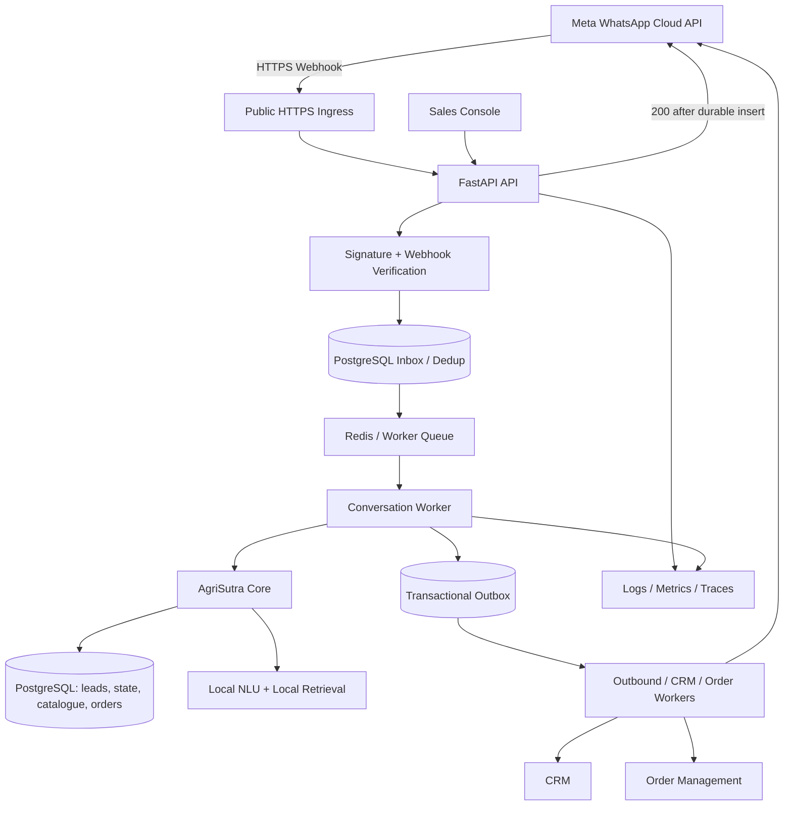

# AgriSutra — Product & Production Blueprint

**Purpose:** Define what the product must do, how the production system is integrated and deployed, how SGB sales staff operate it, and what must be true before real customers, orders or payments are connected.  
**Status:** Proposed product specification and production plan. No production integration is represented as already configured.

---

## 1. Product definition

### 1.1 Product statement

AgriSutra is SGB Agro Industries' evidence-first digital sales executive. It handles incoming customer enquiries, discovers the customer's actual requirement, explains approved products, makes defensible recommendations, applies authorised commercial policy, and moves the enquiry to a salesperson or an approved order workflow.

It must sound like a knowledgeable sales executive while behaving like a governed decision system: it may be helpful and persuasive, but it may not invent a product fact, discount, stock promise or order status.

### 1.2 Business objective

The supplied project README reports approximately **200–250 product enquiries per day** across Meta ads and WhatsApp. Treat this as a planning figure reported by the project source, not an independently validated service-level baseline. Before production capacity planning, measure actual daily volume, hourly peaks, message concurrency, media share, agent capacity and conversion rates.

Product outcomes:

- reduce repetitive product-information work for the sales team;
- qualify leads consistently and retain the full conversation context;
- improve the relevance and transparency of product recommendations;
- reduce unsupported claims and unauthorised price promises;
- shorten the time from enquiry to useful response;
- transfer complex cases to humans without forcing customers to repeat themselves;
- create clean, traceable CRM and order records.

### 1.3 Product positioning

**Not:** a generic chatbot that generates plausible agricultural product advice.  
**Instead:** a sales decision engine with a conversational front end, a governed product catalogue, a proof trail, and a human-controlled commercial workflow.

---

## 2. Users and permissions

| User / role | Needs | Permissions |
|---|---|---|
| Customer | Simple answers, relevant products, accurate prices, a clear way to reach a person | Send messages, provide requirements, consent / opt out, accept or decline a current quote/order preview |
| Sales agent | Transcript, customer context, product evidence, objection history and next action | View assigned leads, take over, reply, request approved exceptions, return control to bot, update lead outcome |
| Sales manager | Queue oversight, commercial approvals and performance | Assign agents, approve eligible price exceptions, inspect audit and team metrics |
| Catalogue administrator | Maintain approved product facts, source images, price validity and correction history | Import / edit catalogue drafts, resolve source issues, publish approved versions |
| System administrator | Secure infrastructure, integrations, availability and incident response | Manage deployment, secrets, roles, logs, backups and integration health; no automatic authority to approve product claims or discounts |
| Evaluator / demo judge | Inspect system decisions and evidence in a simulated environment | Read-only access to demo conversations, state diffs, Truth Receipts and mock orders; no production PII |

A person may hold multiple roles, but permissions must be explicit and audited. Catalogue publishing and discount approval should not be silently granted to every sales agent.

---

## 3. Product experience and key journeys

### 3.1 Entry and guided discovery

The supplied SGB flowchart shows a Meta Ads → WhatsApp journey. The welcome experience should provide four paths:

- Wheel Barrow → Normal / Dumper;
- Brush Cutter Trolley → Sidepack / Backpack;
- Other Products / Enquiry;
- free text at any point.

Buttons are shortcuts, not a constraint. A customer may ignore the menu and type naturally. The system must map the message into the same product-family and Need Fingerprint workflow.

### 3.2 Product-specific discovery

**Brush cutter trolley attachment**

First distinguish a trolley attachment from a complete brush cutter with trolley. Then ask whether the customer's existing brush cutter is sidepack or backpack. If exact make/model fitment is essential, consult an approved compatibility matrix or route to a salesperson; the supplied catalogue does not contain a precise fitment table.

**Wheel barrow**

Distinguish the standard wheel barrow from the dumper variant. Ask whether a tipping / dumper mechanism is required. If the customer requires a numerical load capacity, dimensions or wheel specification, mark the fact unknown until SGB publishes an approved specification.

**Brush cutters**

Distinguish the Varsha push-type trolley configuration from the 143R Stable and 143R WALBRO machines. Use only approved fields such as listed engine type, power, carburetor and warranty. Resolve the “43 cc” artwork versus specification-table omission before exposing engine capacity for the two 143R products.

### 3.3 Recommendation

The customer sees one or two relevant options with concise reasons and limitations. The operator can expand the Truth Receipt and inspect the exact catalogue source. The product card must distinguish facts, customer-specific fit, and unknowns. Never display a pseudo-precise percentage unless it is calculated from a defined set of comparable, known preferences.

### 3.4 Objection and negotiation

The system may explain approved value propositions and re-state the current approved price. It may offer a discount only if a live, effective-dated DealGuard policy permits that exact concession for that product and channel. Otherwise, it says that a salesperson must confirm and hands over the request.

The supplied documents do not include a discount table or approval hierarchy. Until SGB supplies them, the production system must have **no automatic discount authority**.

### 3.5 Follow-up

A follow-up may be scheduled when the customer asks for it or has given the required permission for the relevant message category. At send time the scheduler must re-check opt-out, consent, WhatsApp customer service window, approved template and conversation ownership. Never send a reminder merely because the customer clicked an advertisement.

### 3.6 Human support

A human can take over from any state. The system sends the agent a Human Takeover Packet and pauses automated replies until the agent explicitly returns control. The customer should not be asked to repeat details already present in the conversation.

### 3.7 Purchase and order confirmation

Production order steps:

1. customer requests to proceed;
2. system prepares an immutable quote / order preview using current approved price and terms;
3. customer reviews product/variant, quantity, delivery details, taxes/charges and conditions;
4. customer explicitly confirms that specific preview;
5. system writes a confirmed order record and sends it to the configured order/CRM service;
6. payment and fulfilment states update only from the authorised system response.

A conversational positive signal is not sufficient. “Looks good”, “send details” and “I am interested” are not final confirmation. In challenge mode, the resulting record is `order_type=MOCK`, the UI says no payment is taken, and no live order adapter is called.

---

## 4. Functional requirements

Priority legend: **P0** = required for initial product / controlled release; **P1** = required before broad production rollout; **P2** = enhancement.

| ID | Priority | Requirement | Acceptance condition |
|---|---|---|---|
| FR-01 | P0 | Accept guided product selections and free text | Customer can use menu buttons or type naturally at every stage |
| FR-02 | P0 | Maintain a multi-turn Need Fingerprint | Current requirement, source message, confidence, status and revision history are visible |
| FR-03 | P0 | Handle corrections and contradictions | Corrected field supersedes old value; ambiguous contradiction triggers clarification |
| FR-04 | P0 | Search and explain approved catalogue products | Every visible product fact maps to an approved source field |
| FR-05 | P0 | Apply hard constraints before ranking preferences | Test suite proves that hard-failing products cannot be selected |
| FR-06 | P0 | Ask a relevant next-best question | Question rationale and candidate reduction are logged; no irrelevant fixed questionnaire |
| FR-07 | P0 | Generate a Truth Receipt for recommendations and product answers | Operator can trace each product claim to source file/page/field/version |
| FR-08 | P0 | Disclose missing or conflicting information | No invented stock, discount, delivery, capacity, fitment or unsupported specification |
| FR-09 | P0 | Distinguish order interest from explicit confirmation | Only a confirmation tied to the current order preview can create an order |
| FR-10 | P0 | Create mock orders in challenge mode | Mock record has explicit type, timestamp, product ID, quantity and confirmation reference |
| FR-11 | P0 | Provide human handoff and bot pause | Transcript and structured context transfer; bot sends no reply while human owns conversation |
| FR-12 | P0 | Prevent duplicate processing | Repeated message / confirmation event produces only one state transition / order |
| FR-13 | P1 | Connect WhatsApp Cloud API | Inbound and outbound message, status and template tests pass in Meta test environment |
| FR-14 | P1 | Enforce opt-in, opt-out and messaging-window rules | No prohibited outbound message; opt-out suppression test passes |
| FR-15 | P1 | Integrate CRM | Customer, lead, transcript reference, status and owner sync using stable external IDs |
| FR-16 | P1 | Add approved pricing and discount policies | Policy version, approver, expiry and decision reason are recorded for every quote |
| FR-17 | P1 | Integrate inventory / availability source | Stock statements are sourced and timestamped; absent data remains unknown |
| FR-18 | P1 | Integrate order management and payment status | Customer confirmation and external order/payment result are separate state changes |
| FR-19 | P1 | Schedule compliant follow-ups | Scheduler rechecks permission, template, 24-hour window and human ownership before sending |
| FR-20 | P1 | Provide sales operator console | Agent can inspect, take over, assign, update and resume conversations |
| FR-21 | P1 | Provide audit and operational dashboards | Decision replay, handoff, queue, send failures and source-version metrics are accessible |
| FR-22 | P2 | Catalogue Change Radar | New catalogue version identifies stale quotes / recommendations and affected active leads |
| FR-23 | P2 | Sales-learning analytics | Anonymised aggregate insights reveal frequent missing fields / objections without auto-training on raw chats |
| FR-24 | P2 | Multilingual support | Each target language has reviewed utterances and separate evaluation results before enablement |

---

## 5. Non-functional requirements and proposed targets

These are engineering targets to validate during load and pilot testing, not measured service guarantees.

| Area | Initial target | Verification |
|---|---|---|
| Local decision latency | p95 under 2 seconds for text interpretation, local retrieval and decision logic on agreed hardware | Reproducible benchmark using a representative catalogue and test set |
| WhatsApp inbound acknowledgement | Persist and acknowledge webhook promptly; target p95 under 1 second for the ingress endpoint | Webhook load test; all expensive work runs asynchronously |
| Availability | 99.5% monthly target for initial production service, subject to hosting and Meta dependencies | Synthetic checks and monthly uptime report |
| Webhook delivery | 100% of accepted unique events either processed or visible in a dead-letter / retry queue | Replay and failure-injection test |
| Duplicate effects | Zero duplicate CRM/order effects in idempotency test suite | Retry / concurrency test |
| Evidence integrity | 100% of customer-visible catalogue product claims have resolvable source evidence | Automated Truth Receipt audit on all release scenarios |
| Mandatory constraints | Zero hard-constraint violations in the release suite | Property-based and scenario tests |
| Privacy | No secrets or unnecessary customer identifiers in application logs | Automated log scan and security review |
| Recovery | Backup restore and queue replay demonstrated before launch | Documented recovery exercise |
| Accessibility | Keyboard-operable operator console; readable mobile customer experience | Manual and automated checks |

Do not optimize for “AI response rate” at the expense of truthful abstention or human escalation. A safe `UNKNOWN` response is a correct outcome when the catalogue does not establish a fact.

---

## 6. Production integrations

### 6.1 WhatsApp Business Platform

Use the official **WhatsApp Business Platform Cloud API** as the production messaging interface. Keep the Graph API version configurable and follow Meta's current onboarding, permissions, phone-number, webhook, template and pricing documentation. Do not use unofficial WhatsApp Web automation or browser scraping.

Required integration work:

- Meta Business account / WhatsApp Business Account and phone-number setup;
- app configuration and required permissions;
- public HTTPS webhook URL and verification token;
- raw-body `X-Hub-Signature-256` validation;
- inbound messages, interactive button/list replies, media references and delivery-status webhooks;
- outbound text and supported product/media message types;
- approved message templates and category management;
- secure token rotation and expiry monitoring;
- webhook event persistence, deduplication, asynchronous processing and replay.

**Current policy controls (re-check before launch):**

- The WhatsApp Business Messaging Policy currently states that the recipient must have provided their phone number/username and opted in to subsequent messages or calls. Capture the scope, source and timestamp of the permission; honor opt-outs.
- A customer message opens or resets the 24-hour customer service window. Within it, replies may be sent without a template. Outside it, business-initiated messaging must use an approved template.
- Automation may be used during the service window, but a prompt and clear human escalation path must remain available.
- Do not request full payment-card numbers, financial account numbers or personal ID card numbers in chat. Use a separately approved payment flow where necessary.
- Categorize and use templates only for their approved purpose. Template rejection, pause or quality changes must suppress affected sends.

A click-to-WhatsApp ad referral is channel context, not a substitute for recording the permission required for later outbound categories. Do not assume that an ad click grants blanket marketing consent.

### 6.2 CRM adapter

No CRM vendor or schema is named in the supplied files. Implement a vendor-neutral adapter interface and configure the actual vendor only after SGB selects it.

Minimum CRM fields:

- stable internal lead ID and external CRM ID;
- normalized customer contact reference and consent status;
- source channel and ad/referral context where available;
- lead status, assigned agent and timestamps;
- Need Fingerprint summary and unresolved fields;
- recommended product IDs and latest Truth Receipt reference;
- quote reference, order reference and outcome;
- transcript / audit reference subject to retention and access rules.

Use upsert semantics keyed by a stable external identifier. Retry transient errors with bounded backoff; place permanent failures in a dead-letter queue and notify operations. Do not make the customer wait for a CRM outage if the enquiry can still be safely recorded locally.

### 6.3 Inventory / availability

The catalogue PDF does not provide current stock. Production availability must come from a designated, authoritative inventory system or remain `UNKNOWN`.

Inventory adapter contract should return:

```json
{
  "product_id": "WB-DUMPER",
  "availability_status": "IN_STOCK | LOW_STOCK | OUT_OF_STOCK | UNKNOWN",
  "quantity_available": null,
  "warehouse_or_region": null,
  "checked_at": "ISO-8601",
  "source_system": "approved-inventory-system"
}
```

A stock response must have a timestamp and scope. Do not use “in stock” indefinitely after a single response. Do not expose warehouse-level detail unless SGB authorizes it.

### 6.4 Pricing and discount policy

The supplied catalogue contains prices but no validity dates or discount rules. SGB must provide an approved product/variant price list with:

- SKU / product ID, currency, list price and unit;
- effective-from and effective-to timestamps;
- tax inclusion / exclusion and any mandatory charges;
- region / channel scope, if applicable;
- minimum authorised price or approved discount ceiling;
- automatic approval threshold;
- required approval role for exceptions;
- approver, approval timestamp and policy version.

If a field is missing or expired, the system cannot promise a current final price. It may display a clearly labelled catalogue reference in prototype mode, or route the customer to sales in production.

### 6.5 Order management and payments

No order-management or payment provider is identified. Do not hardwire one in the core sales engine.

Implement separate adapters:

- `QuoteProvider`: creates / retrieves a current approved quote;
- `OrderProvider`: creates and retrieves production orders;
- `PaymentProvider`: creates an authorised payment instruction and returns payment status;
- `FulfilmentProvider`: reports dispatch / delivery events if available.

Order creation must be idempotent and tied to a quote version and explicit customer confirmation. Payment success must come from the payment provider's verified callback or API, never from a customer text statement. An order is not delivered, paid or fulfilled merely because an external request was accepted.

### 6.6 Human-agent console

The operator console should provide:

- live queue with age, priority, reason and assigned owner;
- transcript with channel timestamps and message delivery status;
- Need Fingerprint and its revision diff;
- recommended products and reasons, including excluded candidates;
- Truth Receipt and unresolved / conflicting catalogue facts;
- quote and discount approval context;
- takeover / reassign / resolve / resume-bot actions;
- visible ownership indicator and bot-paused state;
- audit timeline and CRM synchronization outcome.

A human agent's manual response becomes part of the conversation record. Agent messages should never be silently rewritten by the bot.

---

## 7. Production architecture and infrastructure

### 7.1 Recommended stack

| Concern | Recommendation | Reason |
|---|---|---|
| API and business core | Python + FastAPI, modular monolith | Fast development, typed request contracts and shared rules with prototype |
| Local NLU | scikit-learn (word/character TF-IDF + Logistic Regression / Linear SVM) | Small, auditable baseline compatible with local training |
| Data validation | Pydantic | Validates incoming events, catalogue records and integration responses |
| ORM / migration | SQLAlchemy + Alembic | Explicit relational models and repeatable schema changes |
| Production database | PostgreSQL | Transactions, constraints, indexing and concurrency control |
| Queue / lock / cache | Redis with a worker system (RQ or Celery) where workload justifies it | Async webhooks, scheduled follow-up and retryable integrations |
| Frontend | React + TypeScript + Vite | Customer simulator and sales cockpit reuse components |
| Search | BM25 / PostgreSQL full-text or a small local index | Sufficient for the initial structured catalogue; no external embedding service required |
| Media | S3-compatible object storage or approved equivalent | Product images and approved documents with controlled access |
| Deployment | Docker images behind HTTPS reverse proxy / managed ingress | Repeatable build and safe webhook endpoint |
| Observability | Structured logs, metrics, tracing and error alerts | Diagnosable message, queue and decision failures |

Use a single application codebase with separate API and worker processes. Add separate services only after measured load or organisational needs justify the operational cost.

### 7.2 Logical deployment



### 7.3 Deployment environments

- **Local development:** SQLite, local model artefacts, browser simulator, mock CRM/order adapters, fake customer identities.
- **Integration / staging:** PostgreSQL, test credentials, Meta test number or approved test WABA, fake CRM/order endpoints, non-production catalogue and templates.
- **Production:** approved WABA and number, production secrets, PostgreSQL backups, queue workers, restricted operator access, live approved catalogue / price policy and real system adapters.

Never reuse production customer records in demo or staging. Use clearly synthetic test data.

### 7.4 Environment configuration

Example variable names only; no secret values belong in the repository:

```dotenv
APP_ENV=development
APP_BASE_URL=http://localhost:8000
DATABASE_URL=sqlite:///./agrisutra.db
REDIS_URL=

META_GRAPH_API_VERSION=
META_APP_ID=
META_APP_SECRET=
META_WEBHOOK_VERIFY_TOKEN=
META_ACCESS_TOKEN=
META_PHONE_NUMBER_ID=
META_WHATSAPP_BUSINESS_ACCOUNT_ID=

CRM_PROVIDER=mock
CRM_BASE_URL=
CRM_CLIENT_ID=
CRM_CLIENT_SECRET=

INVENTORY_PROVIDER=mock
ORDER_PROVIDER=mock
PAYMENT_PROVIDER=mock

CATALOGUE_SOURCE_PATH=./data/catalogue/source
CATALOGUE_APPROVED_VERSION=
MODEL_ARTIFACT_PATH=./models/intent
MODEL_VERSION=

DEFAULT_TIMEZONE=Asia/Kolkata
FOLLOW_UP_ENABLED=false
OUTBOUND_MESSAGING_ENABLED=false
```

Production secrets must be injected by a secret manager or protected deployment environment. Do not commit `.env`, access tokens, App Secret, real customer records or database dumps.

---

## 8. Security, privacy and compliance

### 8.1 Minimum security controls

- TLS for all public and internal service traffic where applicable.
- Verify webhook signatures over the raw request body before processing.
- Store Meta tokens, App Secret, CRM credentials and payment keys outside source control.
- Apply least-privilege access for agents, managers, catalogue admins and operators.
- Enforce object-level authorization for every conversation, order and evidence endpoint.
- Encrypt databases, backups and sensitive identifiers at rest using the deployment platform's managed controls.
- Avoid storing phone numbers and addresses in model training data or analytics. Use pseudonymous references where possible.
- Sanitize logs; never log access tokens, full payment credentials or unnecessary personal data.
- Set backup retention and test restores; restrict backup access.
- Rate limit inbound API routes and protect operator login with strong authentication.
- Track administrative changes to catalogue, prices, discount policy, user permissions and integration configuration.
- Perform dependency scanning, patching, secret scanning and a security review before launch.

### 8.2 Privacy-by-design workflow

Before collecting information, show a clear notice describing the business, purpose and categories of data collected. Collect only what is required for the enquiry, fulfilment or support purpose. Capture consent / opt-in as a structured record with text/version, scope, channel, timestamp and source. Provide a simple opt-out path and enforce suppression across all campaigns and scheduled jobs.

Define retention periods for raw webhook payloads, transcripts, lead records, quotes, orders, audit trails and backups. Not all data should have the same retention period. Separate operational records from model-training corpora; training use requires an approved lawful basis, minimisation, redaction and review.

### 8.3 India DPDP status — dated engineering note

The Digital Personal Data Protection Rules, 2025 Gazette was published on **13 November 2025**. The Rules themselves state:

- Rules 1, 2 and 17–21 commenced on publication;
- Rule 4 commences one year after publication, i.e. **13 November 2026**;
- Rules 3, 5–16, 22 and 23 commence eighteen months after publication, i.e. **13 May 2027**.

The DPDP Act has a separate commencement notification and a phased schedule. Therefore, do not describe the entire Act and every Rule as simultaneously effective on this document's date. At **21 November 2026**, Rule 4's scheduled commencement date has passed, while the 18-month tranche is still scheduled for May 2027. Confirm the exact provisions in force, amendments, notifications and applicability with qualified Indian counsel at deployment time.

This phased timeline is not a reason to postpone privacy engineering. Prepare for lawful notice and consent, purpose limitation, data minimisation, accuracy, retention limits, security safeguards, grievance / rights handling and accountable processor arrangements from the beginning.

### 8.4 WhatsApp policy controls — current source check

The Meta policy page inspected for this specification states it was last updated **23 September 2026**. It requires opt-in permission for subsequent messages/calls, asks businesses to honor opt-outs, restricts non-template replies to the 24-hour customer service window, requires approved templates outside that window, and expects clear escalation paths when automation is used. It also warns against collecting full payment-card and certain sensitive identifiers in chat.

These are versioned platform rules, not constants. The release checklist must include a fresh policy review and an owner responsible for checking future changes.

---

## 9. Reliability, monitoring and incident response

### 9.1 Reliability patterns

- **Webhook inbox:** durable event insert and duplicate key before acknowledging delivery.
- **Transactional outbox:** queue outbound WhatsApp / CRM / order operations from committed state transitions.
- **Idempotency:** unique keys for incoming provider messages, quote confirmations, order creation and external CRM sync.
- **Retries:** bounded exponential backoff with jitter for transient network / provider errors; permanent policy or validation errors are not blindly retried.
- **Dead-letter queue:** preserve failed events and expose a safe manual replay operation.
- **Concurrency:** serialize updates per conversation or use optimistic revision checks so two fast messages cannot overwrite state.
- **Circuit breaker / suppression:** stop repeated external calls during a provider outage; keep a recorded pending state.
- **Graceful fallback:** when model inference fails, respond with a safe acknowledgement and route to a human; do not fabricate a recommendation.
- **Human ownership:** queued bot responses are rechecked just before sending and suppressed if the conversation has become human-owned.

### 9.2 Monitoring metrics

**Messaging:** webhook requests, signature failures, duplicate events, queue age, send accepted/delivered/failed, template rejection, API error category.  
**AI / decision:** intent distribution, confidence and abstention rate, slot extraction precision on evaluation set, unknown response frequency, unsupported-claim tests, hard-constraint violations.  
**Sales:** enquiry volume, qualified leads, recommendation acceptance, objections, discount handoffs, human handoff rate, follow-up responses and order conversion.  
**Operations:** CRM sync failures, order sync latency, inventory age, catalogue import failures, stale price policy, model / catalogue version distribution.

Sales dashboards must aggregate and minimize personal data. Do not turn a high recommendation acceptance rate into an incentive to bypass evidence gates.

### 9.3 Incident playbooks

| Incident | Immediate response | Recovery |
|---|---|---|
| Meta webhook failures | Alert; retain provider retry path; inspect ingress and signature logs | Restore HTTPS endpoint, replay pending inbox events and confirm no duplicate effects |
| Bad catalogue import | Stop publishing; revert to last approved catalogue version | Correct mapping, rerun validation and require catalogue owner approval |
| Incorrect price / discount promise | Disable quote / discount path for affected SKU; escalate open conversations | Correct price policy, identify affected leads, notify managers and contact customers via approved channel |
| Bot sends during human takeover | Disable outbound worker for affected queue / conversations | Fix ownership lock, replay suppressed events only after agent review |
| Duplicate order | Stop repeated order dispatch; reconcile internal and external IDs | Enforce idempotency and reconcile with order provider before resuming |
| Model quality regression | Roll back to prior validated model or safe rule-only mode | Re-run held-out and adversarial tests; publish a new approved model version |
| Data exposure / suspected breach | Follow incident response, restrict access and preserve necessary evidence | Notify designated security/privacy owners and follow applicable legal / contractual notification duties |

---

## 10. Catalogue governance and the Catalogue Change Radar

A product catalogue is a controlled data product, not a flat prompt or a static JSON file.

### 10.1 Publication lifecycle

`SOURCE_RECEIVED → INGESTED_DRAFT → VALIDATION_WARNINGS → OWNER_REVIEW → APPROVED → PUBLISHED → SUPERSEDED`

Only `APPROVED` / `PUBLISHED` facts may be used for production claims. Keep the original source file, file hash, import timestamp, mapping version, approver and field-level evidence locator.

### 10.2 Change Radar (high-impact enhancement)

When a new catalogue or price list is imported:

1. compare the new version to the previously published version;
2. show price/specification/availability/warranty/image changes by product;
3. identify which open recommendations, unexpired quotes and pending follow-ups reference changed facts;
4. mark affected quotes as requiring review when their price validity or policy changes;
5. notify the catalogue owner and assigned sales agents;
6. preserve the exact version used by already-confirmed orders.

This prevents old conversations from quoting new prices while old pending quotes continue to appear current. It also gives SGB a visible audit trail of why a customer's earlier recommendation changed.

### 10.3 Missing-data feedback loop

Aggregate customer questions that repeatedly hit `MISSING` or `CONFLICTED` fields—for example load capacity, exact trolley fitment or running-time conditions. Produce an admin report of the missing facts with anonymised counts. SGB product owners decide which fields to document. Do not have the model invent the missing fact or automatically publish an inferred specification.

---

## 11. Rollout plan

### Stage 0 — Data and policy readiness

- Confirm the official challenge / business brief and resolve any model/API restrictions.
- Approve canonical product IDs, images, prices and source fields.
- Resolve the Normal Wheel Barrow 95 L wording and the 143R 43 cc artwork discrepancy.
- Supply compatibility matrix, warranty terms, stock source, delivery terms, discount rules, tax treatment and current effective-dated price list where applicable.
- Select CRM, inventory, order and payment systems; name business owners.

**Exit:** no unresolved catalogue conflict is exposed to the live customer path; product and commercial data owners are identified.

### Stage 1 — Local challenge prototype

- Implement local simulator, local NLU and search, Need Fingerprint, AskSmart, recommendation engine, Truth Receipt, Decision Replay, DealGuard in no-discount mode, human handoff simulation and mock order.
- Test with synthetic conversations and the supplied catalogue.

**Exit:** challenge definition-of-done in `README.md` passes; no external customer or production-system side effect is possible.

### Stage 2 — Internal staging integration

- Configure Meta test setup and webhook endpoint.
- Test signature verification, inbox deduplication, templates and service-window logic.
- Connect sandbox / mock CRM and order adapters.
- Rehearse human takeover and pause/resume with sales staff.

**Exit:** security review and integration test suite pass; no real outbound campaigns or payment actions.

### Stage 3 — Shadow mode

- Receive a limited set of real enquiries only through a legally approved, monitored process.
- The bot proposes intent, slots and recommendations to staff but does not send customer-facing replies or create orders.
- Compare its output with sales staff decisions, review false positives and catalogue gaps.

**Exit:** approved accuracy / safety thresholds met on representative reviewed traffic; management signs off on pilot.

### Stage 4 — Agent-in-the-loop pilot

- Enable customer replies for a restricted group / queue with a human watching the conversation.
- Keep automatic discount offers, payments and final order creation disabled until each is independently approved.
- Use an explicit human handoff and kill switch.

**Exit:** no unresolved severe policy or evidence failures; sales team accepts the workflow; incidents and rollback are rehearsed.

### Stage 5 — Controlled production expansion

- Add approved pricing policy, CRM sync, stock lookup, order workflow and selected follow-up templates one at a time.
- Increase traffic only after reliability and customer-experience metrics remain within targets.
- Review platform rules, catalogue and privacy controls on a regular schedule.

**Exit:** each integration has its own owner, test contract, monitoring, rollback and approval record.

---

## 12. Production release checklist

### Product truth

- [ ] All product names, variants, prices and images approved by SGB.
- [ ] Price list includes currency, unit, tax treatment and effective dates.
- [ ] Capacity, compatibility, runtime, warranty and technical conflicts are resolved or visibly marked unknown.
- [ ] Inventory and delivery responses come from approved systems or remain unknown.
- [ ] Discount and exception policy is signed off by an authorised owner.

### Conversation and recommendations

- [ ] Free-text and guided flows are both tested.
- [ ] Corrections and contradictions update Need Fingerprint correctly.
- [ ] Hard constraints cannot be overridden by soft scores.
- [ ] AskSmart is tested against a static question baseline.
- [ ] Every product claim has a resolvable Truth Receipt.
- [ ] Unsupported questions produce a clear fallback or human handoff.

### WhatsApp and CRM

- [ ] WhatsApp Business Account, phone number, app permissions and Cloud API setup approved.
- [ ] Webhook verification and `X-Hub-Signature-256` validation tested.
- [ ] Duplicate, delayed and out-of-order webhook events are tested.
- [ ] Opt-in, opt-out and service-window / template logic are tested.
- [ ] Human escalation path is visible and staffed.
- [ ] CRM upsert, failure, retry and reconciliation tests pass.

### Orders and payments

- [ ] Quote preview is immutable and versioned.
- [ ] Explicit confirmation is tied to the exact quote preview.
- [ ] Duplicate confirmation cannot create duplicate orders.
- [ ] External order result is reconciled and stored.
- [ ] Payment status is only accepted from the authorised payment system.
- [ ] No card or sensitive account identifiers are collected in conversational text.

### Security, privacy and operations

- [ ] Privacy notice, consent records, opt-out and retention schedule reviewed.
- [ ] Applicable DPDP obligations and WhatsApp policy reviewed by designated owners / counsel.
- [ ] Role-based access and conversation isolation tested.
- [ ] Secrets, encryption, backups, restore and incident procedures tested.
- [ ] Logs are redacted and decision replay is access-controlled.
- [ ] Monitoring, alerting, rollback and kill switch verified.
- [ ] Sales agents and managers trained; escalation rota established.

---

## 13. Risk register

| Risk | Likelihood / impact | Mitigation |
|---|---|---|
| Catalogue facts are incomplete or inconsistent | High / High | Source-level evidence, ingestion warnings, owner approval and unknown-by-default behaviour |
| Current prices differ from the PDF | High / High | Effective-dated approved price list; prohibit unverified production quotation |
| 143R artwork/specification mismatch | Medium / High | Keep 43 cc unapproved until product owner confirms |
| Customer means attachment but bot recommends complete machine (or vice versa) | Medium / High | Product-family disambiguation before recommendation |
| Unauthorised discounts or delivery promises | Medium / High | DealGuard policy-as-code; no-policy means no concession |
| Webhook retries create duplicate CRM/order records | Medium / High | Inbox dedupe, idempotency, transactional outbox and replay tests |
| Human and bot reply simultaneously | Medium / High | Conversation ownership lock and send-time bot-paused recheck |
| WhatsApp policy changes or template rejected | Medium / High | Policy owner, current-doc review, template status monitoring and suppression |
| Model mishandles mixed language / spelling | Medium / Medium | Held-out language-specific data, confidence fallback and human handoff |
| Training data leaks customer information | Medium / High | Data separation, minimisation, redaction, access review and approved training process |
| Overengineering slows initial delivery | High / Medium | Modular monolith, seven-product scope, staged integration and strict P0 focus |

---

## 14. Research and primary references

### Research papers

1. Christakopoulou, K., Radlinski, F. & Hofmann, K. (2016). [Towards Conversational Recommender Systems](https://research.google/pubs/towards-conversational-recommender-systems/). Proceedings of ACM SIGKDD. Research motivation for adaptive preference elicitation and asking a small number of high-value questions.
2. Gao, C., Lei, W., He, X., de Rijke, M. & Chua, T.-S. (2021). [Advances and challenges in conversational recommender systems: A survey](https://doi.org/10.1016/j.aiopen.2021.06.002). *AI Open*, 2, 100–126. Research framing for preference elicitation, dialogue strategies, exploration and evaluation.
3. Jannach, D. (2023). [Evaluating conversational recommender systems: A landscape of research](https://doi.org/10.1007/s10462-022-10229-x). *Artificial Intelligence Review*, 56, 2365–2400. Basis for component-level and user-centred system evaluation.
4. Budzianowski, P. et al. (2018). [MultiWOZ: A Large-Scale Multi-Domain Wizard-of-Oz Dataset for Task-Oriented Dialogue Modelling](https://aclanthology.org/D18-1547/). EMNLP. Reference for task-oriented dialogue state and belief-state annotation.
5. Lewis, P. et al. (2020). [Retrieval-Augmented Generation for Knowledge-Intensive NLP Tasks](https://arxiv.org/abs/2005.11401). NeurIPS. Motivation for retrieving external evidence and addressing provenance; AgriSutra uses retrieval without requiring the paper's pretrained generator.
6. Robertson, S. & Zaragoza, H. (2009). [The Probabilistic Relevance Framework: BM25 and Beyond](https://doi.org/10.1561/1500000019). *Foundations and Trends in Information Retrieval*. Basis for the local BM25 retrieval baseline.
7. Ziegfeld, L., Di Scala, D. & Cremers, A. H. M. (2025). [The effect of preference elicitation methods on the user experience in conversational recommender systems](https://doi.org/10.1016/j.csl.2024.101696). *Computer Speech & Language*. Its study of 66 agriculture / forestry participants found objective differences in chat duration, response time and recommendation performance across elicitation conditions, while measured self-report constructs did not differ significantly. Use it to justify testing both guided menus and free text, not to declare one best.
8. [Learning a Strategy for Preference Elicitation in Conversational Recommender Systems](https://doi.org/10.1109/IJCNN60899.2024.10650365) (IJCNN 2024). Studies information-gain-based question selection and provides a future benchmark for AskSmart.

### Platform / regulatory primary sources

- Meta, [WhatsApp Business Messaging Policy](https://whatsappbusiness.com/policy/) — inspected version states last updated 23 September 2026. Re-check before production go-live.
- Meta for Developers, [WhatsApp Business Platform](https://developers.facebook.com/documentation/business-messaging/whatsapp/overview/) — Cloud API, message types, templates, webhook, authentication and pricing docs.
- Meta for Developers, [Cloud API vs. On-Premises API](https://developers.facebook.com/docs/whatsapp/cloud-vs-onprem) — Meta describes Cloud API as the preferred option and explains hosting / operational trade-offs.
- Meta for Developers, [Webhooks: Getting Started](https://developers.facebook.com/docs/graph-api/webhooks/getting-started/) — HTTPS endpoint, verification, `X-Hub-Signature-256` and retry guidance.
- Government of India, MeitY, [Digital Personal Data Protection Rules, 2025 — Gazette](https://www.meity.gov.in/static/uploads/2025/11/53450e6e5dc0bfa85ebd78686cadad39.pdf) — phased commencement of the Rules.
- Government of India, MeitY, [DPDP Act commencement notification](https://www.meity.gov.in/static/uploads/2025/11/c56ceae6c383460ca69577428d36828b.pdf) — separate phased commencement notification for the Act.

*This document is a product and engineering plan. It is not legal advice, a Meta compliance certification, a security audit, or proof that SGB's CRM / inventory / order / payment providers have been selected.*
